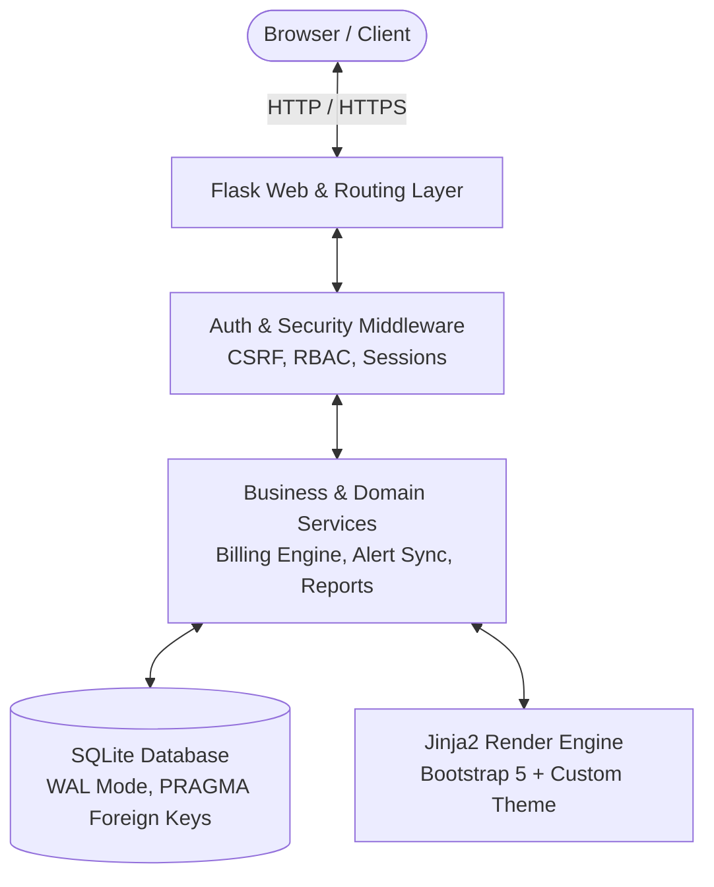
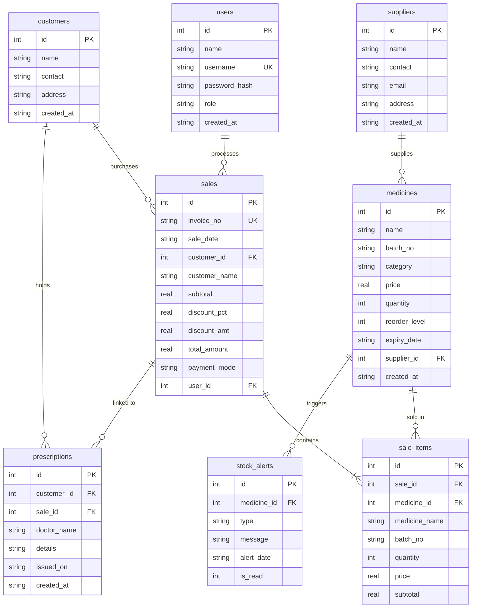

# Technical Approach & Architectural Specification
## MediCare Pharmacy — Medical Store Management System

This document provides an in-depth technical analysis of the architectural patterns, database modeling, business logic rules, transactional integrity mechanisms, and security protocols implemented across the **MediCare Pharmacy** management web application.

---

## 1. System Overview & Architecture

The application is structured as a robust, lightweight **Model-View-Controller (MVC) / Multi-Tier Monolith** designed for high reliability, zero-configuration deployment, and absolute data integrity for pharmacy operations.



### Technology Stack
* **Language & Runtime:** Python 3.9+
* **Web Framework:** Flask 3.1+ (WSGI, Jinja2 templating, Werkzeug security)
* **Persistence Layer:** SQLite 3 with transactional concurrency control (`BEGIN IMMEDIATE`)
* **Financial Computation:** Python `decimal.Decimal` with `ROUND_HALF_UP` quantization
* **UI/UX Framework:** Bootstrap 5.3 + Bootstrap Icons + Custom CSS3 Design System
* **Client-side Interactivity:** Vanilla ES6+ JavaScript (zero external JS runtime frameworks)
* **Automated Testing:** Python `unittest` suite (25 automated test cases)

---

## 2. Relational Database Design & Data Modeling

The schema ([schema.sql](schema.sql)) consists of 8 normalized relational tables enforcing foreign key constraints (`PRAGMA foreign_keys = ON`).



### Key Schema Decisions
1. **Invoice Historical Immutability (De-normalization Pattern):**
   - Tables `sales` and `sale_items` store snapshots of `customer_name`, `medicine_name`, `batch_no`, and `price` at the exact moment of sale.
   - If a medicine or customer is deleted from the master table in the future, foreign keys are set to `NULL` (`ON DELETE SET NULL`), but the invoice numbers, line items, and financial values remain permanently intact.
2. **Integrity Constraints:**
   - `medicines.quantity >= 0` ensures stock can never become negative.
   - `UNIQUE(name, batch_no)` prevents accidental duplication of the same batch.
   - `CHECK (discount_pct >= 0 AND discount_pct <= 100)` validates promotional bounds.

---

## 3. Core Technical Pillars & Business Logic

### A. All-or-Nothing Transactional Billing Engine (`create_sale`)
In [app.py](app.py), sales billing is executed inside an atomic `BEGIN IMMEDIATE` transaction context.

```python
with transaction(db):
    # 1. Fetch live medicine records directly from the database (never trust client prices)
    # 2. Re-validate expiration dates against today's date
    # 3. Check inventory quantities for all line items
    # 4. Atomically deduct quantities using optimistic locking:
    cur = db.execute(
        "UPDATE medicines SET quantity = quantity - ? "
        "WHERE id=? AND quantity >= ? AND expiry_date > ?",
        (qty, med["id"], qty, ref.isoformat())
    )
    if cur.rowcount != 1:
        raise BillingError("Stock changed or medicine expired during checkout. Rolling back.")
    
    # 5. Insert invoice record & line items
    # 6. Auto-generate sequential invoice number: INV-00042
```

#### Why This Matters:
* **Zero Race Conditions:** If two pharmacists attempt to bill the last remaining box of Amoxicillin simultaneously, SQLite's immediate lock combined with `quantity >= ?` prevents stock from going negative.
* **Rollback on Any Failure:** If any item fails validation, the entire transaction rolls back cleanly without creating orphan records or partial stock decrements.

### B. High-Precision Financial Rounding
To prevent IEEE-754 floating-point inaccuracies common in currency calculations:
* All financial arithmetic is performed using Python's `decimal.Decimal`.
* Calculations are rounded using `ROUND_HALF_UP` to two decimal places:
  $$\text{Subtotal} = \sum (\text{Price} \times \text{Qty})$$
  $$\text{Discount Amount} = \text{round}\left(\frac{\text{Subtotal} \times \text{Discount\%}}{100}\right)$$
  $$\text{Total} = \text{Subtotal} - \text{Discount Amount}$$

### C. Regulatory Compliance: Expired Medicine Blocking
A strict **two-tier defense** guarantees that expired batches can never be dispensed:
1. **Client-Tier Protection:** In the billing interface, expired batches are disabled, greyed out, and tagged with an `EXPIRED` badge.
2. **Server-Tier Hard Check:** Inside the `create_sale` database transaction, the server queries the database's `expiry_date` and verifies that `expiry_date > today()`. If an expired medicine is submitted via manipulated HTTP POST requests, the transaction immediately raises `BillingError` and aborts.

### D. Self-Healing Alert Engine (`sync_alerts`)
The system features a reactive state machine that monitors medicine stock and expiry:
* **Alert Types:**
  - `expired`: `expiry_date <= today`
  - `expiring_soon`: `today < expiry_date <= today + 30 days`
  - `out_of_stock`: `quantity <= 0`
  - `low_stock`: `0 < quantity <= reorder_level`
* **Automated Lifecycle:** Alerts dynamically synchronize on incoming requests. When a pharmacist restocks or removes an expired batch, the corresponding alert is automatically resolved and pruned from the database.

---

## 4. Security & Authentication Architecture

### Authentication & Sessions
* **Password Security:** Salted hashes generated via Werkzeug (`scrypt` or `pbkdf2:sha256`) with cryptographic work factors. Plaintext passwords are never stored or logged.
* **Session Management:** Secure Flask client-side cookie sessions with:
  - `SESSION_COOKIE_HTTPONLY = True` (prevents XSS cookie theft)
  - `SESSION_COOKIE_SAMESITE = "Lax"` (mitigates CSRF vulnerabilities)
  - `PERMANENT_SESSION_LIFETIME = timedelta(hours=8)`

### Role-Based Access Control (RBAC)
Two distinct user roles are enforced through Python function decorators:
* `@login_required`: Required for operational pharmacy functions (billing, viewing inventory, alerts, customers).
* `@admin_required`: Restricts destructive operations (deleting medicines, suppliers, or customers; managing users and passwords).

```python
def admin_required(fn):
    @wraps(fn)
    def wrapper(*args, **kwargs):
        if not session.get("user_id"):
            return redirect(url_for("login", next=request.path))
        if session.get("role") != "admin":
            flash("Admin privileges required for this action.", "danger")
            return redirect(url_for("dashboard"))
        return fn(*args, **kwargs)
    return wrapper
```

### CSRF Protection
A token is generated and bound to each session (`csrf_token`). All modifying HTTP POST requests are validated:
* Validated against `request.form["csrf_token"]` or the `X-CSRFToken` request header.

---

## 5. Frontend & UI/UX Engineering

The user interface balances clean healthcare ergonomics with fast load performance:
* **Design Tokens:** Modern medical palette featuring an emerald/teal primary brand color (`#059669` / `#10b981`), neutral slate backgrounds (`#f8fafc`), and high-contrast typography.
* **Print Engine:** Dedicated `@media print` CSS rules in [static/css/style.css](static/css/style.css) automatically reformat the invoice screen into a clean, borderless, receipt-ready layout, stripping away headers, sidebars, and navigation controls.
* **No External Framework Dependencies:** Core logic operates without heavy JavaScript frameworks (React/Vue/Angular), reducing bundle weight to under 40 KB and enabling instant load times.

---

## 6. Testing & Quality Assurance

The automated test suite in [tests/test_app.py](tests/test_app.py) contains **25 comprehensive tests**:

| Test Group | Coverage |
|---|---|
| **Authentication & RBAC** | Login/logout, password hashing, role enforcement, CSRF rejections |
| **Medicine & Supplier CRUD** | Input validation, unique batch constraints, foreign key cascades |
| **Billing & Transactions** | Stock deduction, monetary rounding, expired item blocking, concurrency rollbacks |
| **Alert Engine** | Triggering low stock, out of stock, expiring soon, and alert dismissal |
| **Reports & Export** | Daily and monthly aggregations, CSV downloads, inventory value calculations |
| **Site Crawl** | Automated crawler testing HTTP status code 200 on every internal link |

To run the test suite:
```bash
python -m unittest discover -s tests -v
```

---

## 7. Production Deployment & Scalability Path

For production environments:
1. **WSGI Application Server:** Replace the development server with **Waitress** (Windows) or **Gunicorn** (Linux):
   ```bash
   pip install waitress
   waitress-serve --port=5000 app:app
   ```
2. **Reverse Proxy & TLS:** Deploy behind Nginx or Caddy with automated HTTPS certificates.
3. **Database Migration to PostgreSQL / MySQL:**
   - All SQL statements use ANSI-compliant syntax (`SELECT`, `INSERT`, `UPDATE`, `JOIN`).
   - SQLite `PRAGMA foreign_keys = ON` can be seamlessly migrated to PostgreSQL or MySQL by swapping the database connector adapter in `connect()`.
